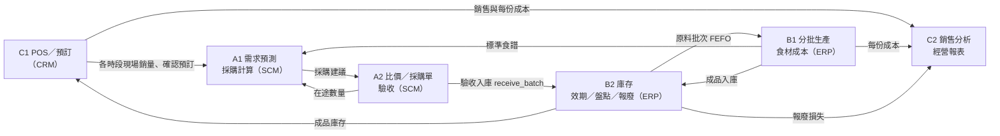

# bento-MIS 便當店管理資訊系統

模仿日本 KITCHEN DIVE 的「超便宜、份量超大」便當店，用 MIS 把管理成本降到最低、銷量做到最大。
閉環流程：**銷售 → 預測 → 採購 → 生產 → 銷售**。

## 問題與目標

便宜又大份的便當一定賣得動，難的是**賺得到錢**。毛利很薄，只要多一點浪費、缺料或人工，就會虧損。所以這套 MIS 的目標是：

1. **不浪費**：只做預測得到的量，原料先到期的先用，報廢要有紀錄、算進成本。
2. **不斷料**：根據預測和庫存自動算出該買多少、最晚哪天下單。
3. **不多花人力**：結帳、扣庫存、入庫、成本計算都由系統完成，管理者只做判斷。
4. **看得到錢**：每份便當的實際成本、報廢損失和各項費用，都能匯進損益表。

## 系統架構：SCM、ERP、CRM

| 系統 | 子系統 | 模組 | 做什麼 |
|---|---|---|---|
| **SCM 供應鏈管理** | 需求預測與採購計算 | A1 `a1/` | 依歷史現場銷售、確認預訂和特殊日期倍率，預測各時段需求，換算原料缺口和建議採購量 |
| | 供應商、採購單、驗收入庫 | A2 `a2/` | 數量級距比價、建立採購單、分批到貨、四項驗收，合格才寫入 B2 庫存 |
| **ERP 企業資源規劃** | 生產管理與食材成本 | B1 `b1_*.py` | 食譜、分批生產、FEFO 領料、每批每份成本、標準成本與實際成本差異 |
| | 庫存管理 | B2 `b2_inventory/` | 原料和成品分批庫存、效期提醒、盤點、報廢、異動紀錄 |
| | 財務與經營報表 | C2 `c2/` | 費用登錄（人事、水電、租金），彙整營收、食材成本、報廢、進貨，算出損益 |
| **CRM 顧客關係管理** | POS 與顧客服務 | C1 `c1/` | 現場結帳並扣成品庫存、巨無霸便當預訂取餐、顧客評分回饋 |
| | 銷售分析 | C2 `c2/` | 各品項、各時段銷售分析，匯出現場銷量給 A1 做預測 |

### 資料怎麼流動



圖上每一條線都已經接通：所有模組讀寫同一個共用資料庫 `bento.db`，用同一套品項代號，不需要手動搬 JSON。

### 各子系統如何運作

**SCM：買得剛好、不囤貨也不斷料**
- A1 用同一個星期幾的歷史銷量做加權平均，越近的日子權重越高，再乘上特殊日期倍率，加上已確認的預訂，得到每個時段的建議製作量。
- 建議製作量乘上食譜用量，就是原料需求。扣掉還沒過期的庫存和在途的貨，再加上緩衝，按包裝量進位成建議採購量。A1 也會依交期算出最晚下單日。
- A2 把建議拿去比價：先看來不來得及到貨，再比總價和單位成本，並提示「多買一級可以便宜多少」。生鮮放不久，所以不會自動多買，由人決定。
- 冷藏庫放不下時，採購單可以分批到貨。驗收時溫度、包裝、外觀、標示四項都通過才收，再自動寫入 B2 庫存。供應商的準時率、允收率和價差會累積成評分，作為下次比價的依據。

**ERP：把每一份的成本算清楚**
- B1 依 A1 的建議量分批製作，只做賣得掉的量。領料時系統自動挑最早到期的原料批次，已過期的不用。
- 每批便當都記錄實際用了哪些原料批次、多少錢，算出每份成本。B1 也會跟標準成本比較，把差異拆成「用量差異」（多用了料）和「價格差異」（買貴了）。
- C2 把營收、食材成本、報廢損失，以及人事、水電、租金等費用彙整成損益表，看出每天到底有沒有賺錢。

**CRM：讓顧客常來、讓大份量不變成浪費**
- C1 現場結帳很快，結帳時就扣成品庫存，庫存不夠會直接擋下，不會超賣。
- 1 公斤和 3 公斤的巨無霸便當成本高，採「先預訂、後製作」，不預先做，就不會報廢。
- 顧客的評分和回饋會回饋給 B1 調整菜單；各時段的銷量則交給 A1，讓下一次預測更準。

### 庫存管理（便當與原物料）

| | 原物料 | 便當成品 |
|---|---|---|
| 入庫 | A2 驗收合格才入庫，記錄批號、效期、數量、單價 | B1 生產完成後入庫，帶有該批成本 |
| 出庫 | B1 生產領料，**FEFO**（先到期先出），過期不可用 | C1 結帳時同樣依 FEFO 扣除，庫存不足不能結帳 |
| 效期 | 以日期管理，B2 提醒即將到期和已過期的批次 | 生產後 **6 小時**到期（記錄到時、分、秒），過期的不能賣；巨無霸便當接單才做 |
| 盤點 | 實盤和帳上數量不同時記錄差異並調整 | 同左 |
| 報廢 | 記錄原因、操作人、金額，算進有效成本 | 同左，B1 會算出報廢率並跟 3% 目標比較 |
| 補貨 | A1 依庫存、在途和預測算缺口，A2 下單 | A1 依時段需求決定每批做幾份 |

所有庫存異動都由 B2 的 `InventoryService` 處理（入庫 `receive_batch`、出庫 `plan_consumption` / `consume`、盤點、報廢），其他模組不直接改庫存表，避免兩邊數字對不起來。

## 技術

Python 3.10 以上 + SQLite。A1、A2、B1、B2、C2 只用標準函式庫；C1 使用 Flask，第一次執行前先安裝：

```bash
pip install flask
```

## 怎麼啟動

### 1. 建立示範資料（一次就好）

```bash
python demo.py --reset
```

它會用各組真正的程式跑一遍完整流程，資料都標示「（模擬）」或「歷史匯入」：

1. **A2** 向（模擬）供應商比價、下採購單、驗收四種原料，寫入 B2 庫存；另有一張明天到貨的單
2. **B1** 依 FEFO 領料，生產雞腿便當 40 份、豆腐便當 25 份、巨無霸便當 1 份
3. **C1** 匯入 28 天歷史銷售，今天現場結帳、巨無霸預訂取餐、建立明天的預訂與顧客回饋
4. **B2** 報廢過期便當、盤點蔬菜短少
5. **C2** 登錄每日費用，從共用資料庫同步 C1 銷售
6. **A1** 讀取系統資料，預測明天各時段需求並算出採購建議

`--reset` 只會刪除本機的 `bento.db`、`a2/data/a2.sqlite3`、`c2/data/c2.sqlite3`，這些檔案都不會上傳 GitHub。

### 2. 開啟各模組

在專案根目錄執行，每個服務用不同的埠，可以同時開，看到的是同一份資料：

| 模組 | 指令 | 網址 |
|---|---|---|
| A1 需求預測與採購計算 | `python a1/server.py` | http://127.0.0.1:8000 |
| B2 庫存 | `python b2_app.py` | http://127.0.0.1:8001 |
| C2 經營分析 | `python c2/server.py` | http://127.0.0.1:8002 |
| A2 供應商、採購單、驗收 | `python a2/server.py` | http://127.0.0.1:8003 |
| C1 POS 與顧客管理 | `python c1/server.py` | http://127.0.0.1:5001 |
| B1 食譜與生產 | `python b1_menu.py` | 文字選單 |

展示建議：在 C1 結帳 → B2 看到成品庫存減少 → C2 按「同步 C1 銷售」看損益 → A1 按「計算需求與採購」看明天要做多少、要買什麼。

### 3. 執行測試

在專案根目錄執行（最後一個需要 Node.js 18 以上）：

```bash
python -m unittest discover -s tests
```

```bash
python a1/test_a1.py
```

```bash
python a2/test_a2.py
```

```bash
python c1/test_c1.py
```

```bash
python -m unittest discover -s c2/tests -p "test_*.py"
```

```bash
node --test c2/tests/*.test.mjs
```

`tests/test_integration.py` 會跑一次完整流程，檢查 A2 驗收是否進到 B2、C1 賣出的成本是否等於 B1 生產成本、C2 是否收到全部 C1 銷售、A1 是否讀到銷售、預訂、庫存與在途。

## 分工

| 組別 | 負責內容 | 資料夾／檔案 |
|---|---|---|
| A1 | 需求預測、採購量計算 | `a1/`、`frontend/` |
| A2 | 供應商、採購單、分批到貨、驗收入庫 | `a2/` |
| B1 | 食譜、分批生產、食材成本 | `b1_*.py` |
| B2 | 庫存、效期、盤點、報廢 | `b2_inventory/`、`b2_app.py`、`B2_README.md` |
| C1 | POS、顧客預訂、取餐、回饋 | `c1/` |
| C2 | 費用登錄、銷售分析、經營報表 | `c2/` |

各模組的詳細說明：[A1](a1/README.md)、[A2](a2/README.md)、[B2](B2_README.md)、[C1](c1/README.md)、[C2](c2/README.md)；B1 見下方。

## 整合方式

| 項目 | 做法 |
|---|---|
| 資料庫 | 共用 `bento.db`（可用環境變數 `BENTO_DB` 改路徑）：B1 品項與食譜、B2 庫存、C1 銷售／預訂／回饋都在這裡。A1 計畫紀錄、A2 採購單、C2 費用是各組自己的業務資料，各自存在 `a1/data/`、`a2/data/`、`c2/data/` |
| 品項代號 | 由 [shared/master.py](shared/master.py) 統一：便當 `chicken_bento`、`tofu_bento`、`giant_1kg`、`giant_3kg`；原料 `rice`、`chicken`、`vegetable`、`tofu` |
| 單位 | 原料一律 **g**，便當一律 **份**。B2 入庫時會檢查單位必須跟主檔一致 |
| 時段 | 17:00 前午餐、21:00 前晚餐、之後宵夜（[shared/config.py](shared/config.py)），A1、C1、C2 共用 |
| A1 輸入 | 按「載入系統資料」：C1 的現場銷量與預訂、B1 食譜（含損耗）、B2 原料庫存、A2 報價與在途 |
| C2 輸入 | 按「同步 C1 銷售」與「同步 B2 報廢」，可依日期篩選 |

### 刻意保留給人判斷的地方

- A1 的採購建議要人看過，再到 A2 貼上比價、建單；不會自動下單。
- B1 要做幾份由廚房依 A1 建議決定，系統不自動生產。
- 這是課堂本機版：只在 127.0.0.1 執行，沒有登入與權限控管。

## B1 模組：食譜、生產與食材成本

| 檔案 | 功能 |
|---|---|
| `b1_db.py` | 建立四張表：Item（品項主檔，含便當售價）、Recipe（食譜）、ProductionBatch（生產批次）、BatchMaterialUsage（領料明細） |
| `b1_production.py` | 新增品項與食譜、分批生產：透過 B2 依 FEFO 扣原料、計算批次成本、成品入庫（6 小時效期） |
| `b1_report.py` | 標準成本 vs 實際成本，差異拆成「用量差異」與「價格差異」 |
| `b1_export.py` | 給 C2 的成本摘要，並整合 B2 的報廢與盤點，算出「有效成本」；可依日期（例如按月）篩選 |
| `b1_menu.py` | 文字選單，把以上功能串起來，可直接展示 |

### 怎麼執行

在專案根目錄：

```bash
python b1_menu.py        # 文字選單（9 進一批示範原料，5 生產，6 差異報表，7 可輸入期間）
python b1_production.py  # 生產與 FEFO 示範
python b1_report.py      # 差異報表示範
python b1_export.py      # 成本與損耗摘要示範
```

示範程式使用獨立的 `*_demo.db`，不會弄亂正式資料。選單使用共用的 `bento.db`，跟其他模組看到同一份庫存。

### 核心規則

- **FEFO**：先到期的原料批次先使用，已過期的不使用。
- **用量換算**：原料需求量 = 每份用量（g）× 產出份數 ÷ (1 − 損耗率)。A1 預測原料需求時用同一個公式。
- **批次成本** = Σ(領用量 × 該原料批次單價)；每份成本 = 批次成本 ÷ 產出份數。
- **有效成本** = (生產成本 + 原料報廢與盤點短少) ÷ 實際賣得出去的份數。
- 生產過程為單一交易：扣料、記錄、成品入庫，全部成功或全部不做。

### 給其他組的介面

| 對象 | 介面 |
|---|---|
| C2 | `from b1_export import cost_summary_for_c2`，傳入 `InventoryService`，取得生產成本、報廢損失、報廢率、有效成本 |
| C1 | 菜單與售價來自 `Item`；成品入庫後 C1 結帳依 FEFO 扣批次，並記下該批的每份成本 |
| B2 | 領料用 B2 的 `plan_consumption` / `apply_consumption`，跟 B1 的生產紀錄放在同一個交易 |
| A1 | `shared.master.products_for_a1` 把 `Recipe` 換成 A1 的食譜格式（含損耗） |

### 已解決的限制

- 領料改用 B2 的正式出庫 API，不再直接改庫存表。
- 成品效期記錄到時間，6 小時一到就不能賣。
- B1 選單、B2、C1、A2、C2 都用同一個 `bento.db`。
- 報廢與盤點損失可依日期篩選。
- 原料單位統一為 g，B2 入庫時會檢查。

## B2 模組

詳見 [B2_README.md](B2_README.md)。
