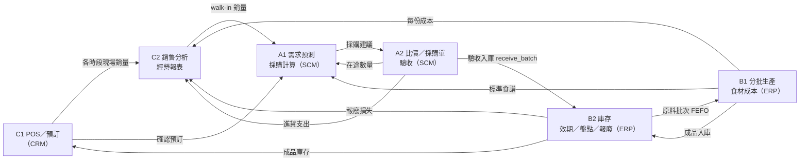

# bento-MIS 便當店管理資訊系統

模仿日本 KITCHEN DIVE 的「超便宜、份量超大」便當店，用 MIS 把管理成本降到最低、銷量做到最大。
閉環流程：**銷售 → 預測 → 採購 → 生產 → 銷售**。

## 問題與目標

便宜又大份的便當一定賣得動，難的是**賺得到錢**。毛利很薄，只要多一點浪費、缺料或人工，就會虧損。所以這套 MIS 的目標是：

1. **不浪費**：只做預測得到的量，原料先到期的先用，報廢要有紀錄、算進成本。
2. **不斷料**：根據預測和庫存自動算出該買多少、最晚哪天下單。
3. **不多花人力**：結帳、扣庫存、入庫、成本計算都由系統完成，管理者只做判斷。
4. **看得到錢**：每份便當的實際成本、報廢損失和各項費用，都能匯進損益表。

## 系統架構：SCM、ERP、CRM

| 系統 | 子系統 | 模組 | 做什麼 |
|---|---|---|---|
| **SCM 供應鏈管理** | 需求預測與採購計算 | A1 `a1/` | 依歷史現場銷售、確認預訂和特殊日期倍率，預測各時段需求，換算原料缺口和建議採購量 |
| | 供應商、採購單、驗收入庫 | A2 `a2/` | 數量級距比價、建立採購單、分批到貨、四項驗收，合格才寫入 B2 庫存 |
| **ERP 企業資源規劃** | 生產管理與食材成本 | B1 `b1_*.py` | 食譜、分批生產、FEFO 領料、每批每份成本、標準成本與實際成本差異 |
| | 庫存管理 | B2 `b2_inventory/` | 原料和成品分批庫存、效期提醒、盤點、報廢、異動紀錄 |
| | 財務與經營報表 | C2 `c2/` | 費用登錄（人事、水電、租金），彙整營收、食材成本、報廢、進貨，算出損益 |
| **CRM 顧客關係管理** | POS 與顧客服務 | C1 `c1/` | 現場結帳並扣成品庫存、巨無霸便當預訂取餐、顧客評分回饋 |
| | 銷售分析 | C2 `c2/` | 各品項、各時段銷售分析，匯出現場銷量給 A1 做預測 |

### 資料怎麼流動



### 各子系統如何運作

**SCM：買得剛好、不囤貨也不斷料**
- A1 用同一個星期幾的歷史銷量做加權平均，越近的日子權重越高，再乘上特殊日期倍率，加上已確認的預訂，得到每個時段的建議製作量。
- 建議製作量乘上食譜用量，就是原料需求。扣掉還沒過期的庫存和在途的貨，再加上緩衝，按包裝量進位成建議採購量。A1 也會依交期算出最晚下單日。
- A2 把建議拿去比價：先看來不來得及到貨，再比總價和單位成本，並提示「多買一級可以便宜多少」。生鮮放不久，所以不會自動多買，由人決定。
- 冷藏庫放不下時，採購單可以分批到貨。驗收時溫度、包裝、外觀、標示四項都通過才收，再自動寫入 B2 庫存。供應商的準時率、允收率和價差會累積成評分，作為下次比價的依據。

**ERP：把每一份的成本算清楚**
- B1 依 A1 的建議量分批製作，只做賣得掉的量。領料時系統自動挑最早到期的原料批次，已過期的不用。
- 每批便當都記錄實際用了哪些原料批次、多少錢，算出每份成本。B1 也會跟標準成本比較，把差異拆成「用量差異」（多用了料）和「價格差異」（買貴了）。
- C2 把營收、食材成本、報廢損失，以及人事、水電、租金等費用彙整成損益表，看出每天到底有沒有賺錢。

**CRM：讓顧客常來、讓大份量不變成浪費**
- C1 現場結帳很快，結帳時就扣成品庫存，庫存不夠會直接擋下，不會超賣。
- 1 公斤和 3 公斤的巨無霸便當成本高，採「先預訂、後製作」，不預先做，就不會報廢。
- 顧客的評分和回饋會回饋給 B1 調整菜單；各時段的銷量則交給 A1，讓下一次預測更準。

### 庫存管理（便當與原物料）

| | 原物料 | 便當成品 |
|---|---|---|
| 入庫 | A2 驗收合格才入庫，記錄批號、效期、數量、單價 | B1 生產完成後入庫，帶有該批成本 |
| 出庫 | B1 生產領料，**FEFO**（先到期先出），過期不可用 | C1 結帳時扣除，庫存不足不能結帳 |
| 效期 | B2 提醒即將到期和已過期的批次 | 現做現賣；巨無霸便當接單才做 |
| 盤點 | 實盤和帳上數量不同時記錄差異並調整 | 同左 |
| 報廢 | 記錄原因、操作人、金額，算進有效成本 | 同左，B1 會算出報廢率並跟 3% 目標比較 |
| 補貨 | A1 依庫存、在途和預測算缺口，A2 下單 | A1 依時段需求決定每批做幾份 |

所有庫存異動都由 B2 的 `InventoryService` 處理，其他模組不直接改庫存表，避免兩邊數字對不起來。

## 技術

Python 3 + SQLite。A1、A2、B1、B2、C2 不需安裝第三方套件；C1 使用 Flask，執行前要先 `pip install flask`。

## 怎麼啟動

在專案根目錄執行，每個服務用不同的埠，可以同時開：

| 模組 | 指令 | 網址 |
|---|---|---|
| A1 需求預測與採購計算 | `python a1/server.py` | http://127.0.0.1:8000 |
| B2 庫存 | `python b2_app.py` | http://127.0.0.1:8001 |
| C2 經營分析 | `python c2/server.py` | http://127.0.0.1:8002 |
| A2 供應商、採購單、驗收 | `python a2/server.py` | http://127.0.0.1:8003 |
| C1 POS 與顧客管理 | `python c1/server.py` | http://127.0.0.1:5001 |
| B1 食譜與生產 | `python b1_menu.py` | 文字選單 |

## 分工

| 組別 | 負責內容 | 資料夾／檔案 |
|---|---|---|
| A1 | 需求預測、採購量計算 | `a1/`、`frontend/` |
| A2 | 供應商、採購單、分批到貨、驗收入庫 | `a2/` |
| B1 | 食譜、分批生產、食材成本 | `b1_*.py` |
| B2 | 庫存、效期、盤點、報廢 | `b2_inventory/`、`b2_app.py`、`B2_README.md` |
| C1 | POS、顧客預訂、取餐、回饋 | `c1/` |
| C2 | 費用登錄、銷售分析、經營報表 | `c2/` |

各模組的詳細說明：[A1](a1/README.md)、[A2](a2/README.md)、[B2](B2_README.md)、[C1](c1/README.md)、[C2](c2/README.md)；B1 見下方。

## 整合現況與待改進

目前每個模組都可以各自執行和展示，但還沒有完全串成一套：

- **品項代號不一致**：C1 用 `B01`、A1 和 C2 用 `chicken`、B1 用 `chicken_bento`，正式串接前要統一成同一套代號。
- **資料庫分開**：A1、A2、C2 各有自己的 SQLite，B1 選單用 `bento.db`，B2 網頁版和 A2 用 `b2_local.db`，整合時要統一。
- **單位不一致**：A1、A2 的範例用 g，B1、B2 用 kg，食譜和庫存必須用同一單位。
- **C1 資料只存在記憶體**：重開伺服器就會清空，成品庫存也還沒接到 B2。

## B1 模組：食譜、生產與食材成本

| 檔案 | 功能 |
|---|---|
| `b1_db.py` | 建立四張表：Item（品項主檔）、Recipe（食譜）、ProductionBatch（生產批次）、BatchMaterialUsage（領料明細） |
| `b1_production.py` | 新增品項與食譜、分批生產：FEFO 扣原料、計算批次成本、成品入庫 |
| `b1_report.py` | 標準成本 vs 實際成本，差異拆成「用量差異」與「價格差異」 |
| `b1_export.py` | 給 C2 的成本摘要，並整合 B2 的報廢與盤點，算出「有效成本」 |
| `b1_menu.py` | 文字選單，把以上功能串起來，可直接展示 |

### 怎麼執行

在專案根目錄：

```bash
python b1_menu.py        # 文字選單（輸入 9 載入示範資料，5 生產，6 差異報表）
python b1_production.py  # 生產與 FEFO 示範
python b1_report.py      # 差異報表示範
python b1_export.py      # 成本與損耗摘要示範
```

示範程式使用獨立的 `*_demo.db`，不會弄亂正式資料。選單使用 `bento.db`。

### 核心規則

- **FEFO**：先到期的原料批次先使用，已過期的不使用。
- **用量換算**：原料需求量 = 每份用量 × 產出份數 ÷ (1 − 損耗率)。
- **批次成本** = Σ(領用量 × 該原料批次單價)；每份成本 = 批次成本 ÷ 產出份數。
- **有效成本** = (生產成本 + 原料報廢與盤點短少) ÷ 實際賣得出去的份數。
- 生產過程為單一交易：扣料、記錄、成品入庫，全部成功或全部不做。

### 給其他組的介面

| 對象 | 介面 |
|---|---|
| C2 | `from b1_export import cost_summary_for_c2`，傳入 `InventoryService`，取得生產成本、報廢損失、報廢率、有效成本 |
| C1 | 成品庫存在 `inventory_batches`（`item_type='bento'`），每份成本在 `ProductionBatch.unit_cost` |
| B2 | 使用 B2 的 `InventoryService`。`Item.code` 必須與 B2 的 `item_id` 完全一致 |
| A1 | 食譜在 `Recipe` 表，可用來由預測製作量反推原料需求 |

### 已知限制與待改進

- 領料目前由 B1 直接扣 `inventory_batches`，待 B2 提供正式 `consume()` 後替換。
- B2 效期只存「日期」，成品 6 小時的效期無法精確表示，需加時間欄位。
- B1 選單使用 `bento.db`，B2 網頁版使用 `b2_local.db`，整合時需統一資料庫檔。
- 報廢與盤點損失目前沒有日期篩選，尚不能按月統計。
- 食譜用量單位須與 B2 的固定庫存單位相同（例如都用 kg）。

## B2 模組

詳見 [B2_README.md](B2_README.md)。
